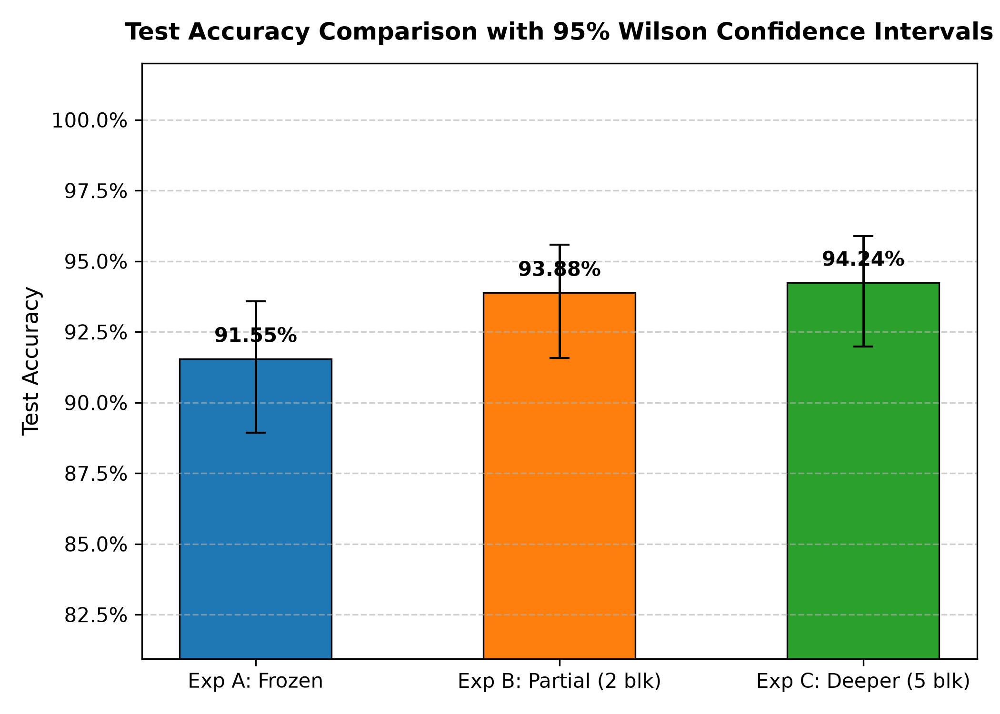
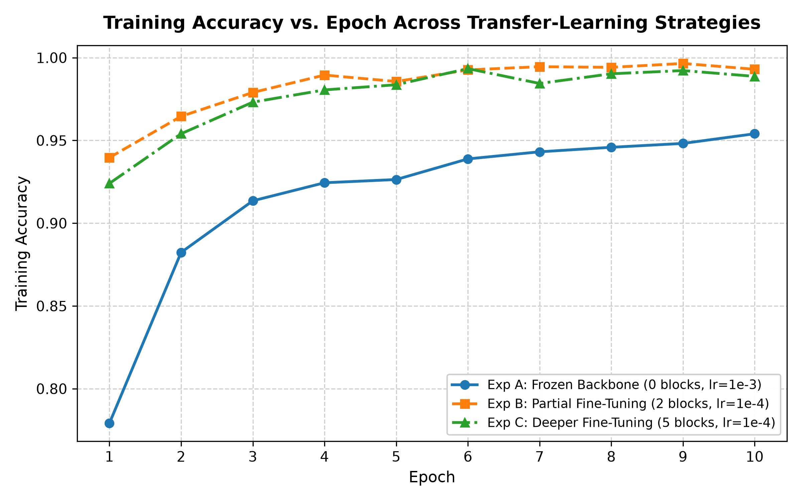
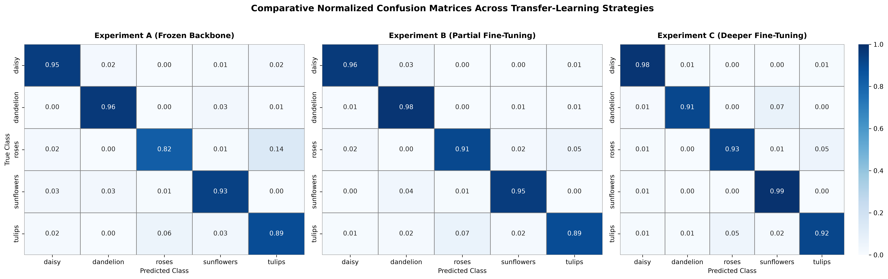
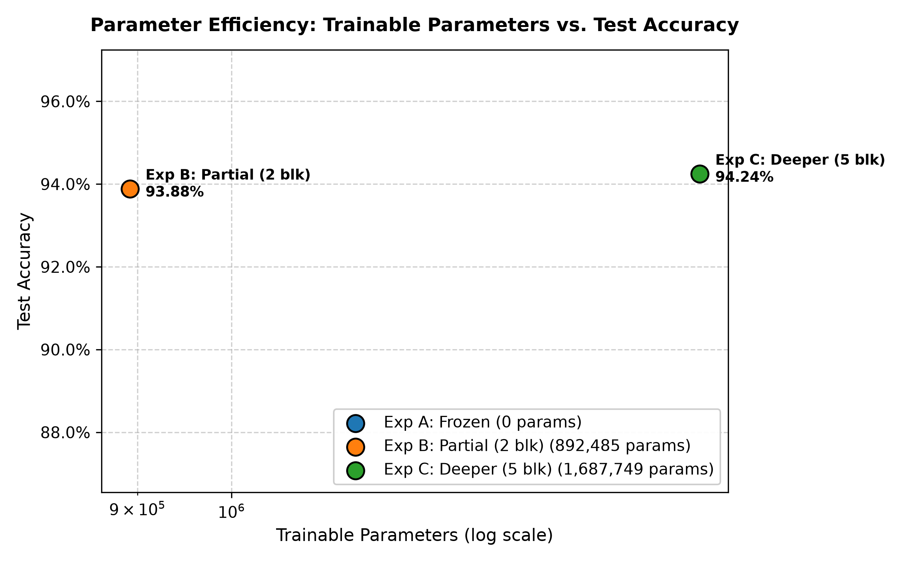

# MobileNetV2 Transfer Learning Research

### An Experimental Study of Fine-Tuning Depth in MobileNetV2 for Image Classification

An experimental deep learning research project comparing three transfer learning strategies using a pretrained **MobileNetV2** architecture on the **TensorFlow Flowers** dataset.

The study evaluates how freezing and fine-tuning different portions of a pretrained convolutional neural network affect classification accuracy, generalization, and computational requirements.

**Research Paper:** IEEE conference-format manuscript in preparation.

---

## Research Objective

**Research Question:** How does fine-tuning depth influence the classification performance of a pretrained MobileNetV2 network?

Three configurations are investigated:

1. **Frozen Backbone:** Train only the classification head.
2. **Partial Fine-Tuning:** Fine-tune the final 2 feature blocks.
3. **Deeper Fine-Tuning:** Fine-tune the final 5 feature blocks.

Experiments B and C independently initialize from Experiment A's best checkpoint.

## Key Results

| Configuration | Validation Accuracy | Test Accuracy | Macro-F1 |
|---|---:|---:|---:|
| Frozen Backbone | 91.59% | 91.55% | 91.30% |
| Partial Fine-Tuning | **94.70%** | 93.88% | 93.81% |
| Deeper Fine-Tuning | 93.42% | **94.24%** | **94.27%** |

**Main observation:** Both fine-tuning approaches improved test accuracy relative to frozen feature extraction.

Deeper fine-tuning achieved the highest numerical test accuracy, but its advantage over partial fine-tuning was not statistically significant (paired McNemar test, p = 0.8501).

These results describe the specific dataset, initialization, and single-seed experimental setup used in this study.

## Experimental Visualizations

### Test Accuracy Comparison



### Training Accuracy



### Confusion Matrices



### Fine-Tuning Depth vs Performance



## Dataset

The TensorFlow Flowers dataset contains **3,670 images** across five classes.

| Flower Class | Images |
|---|---:|
| Daisy | 633 |
| Dandelion | 898 |
| Roses | 641 |
| Sunflowers | 699 |
| Tulips | 799 |
| **Total** | **3,670** |

Dataset partitions:

- Training: 2,567 images
- Validation: 547 images
- Testing: 556 images

The original dataset is available from:

https://storage.googleapis.com/download.tensorflow.org/example_images/flower_photos.tgz

The test partition was kept separate during model development.

## Model Architecture

- Backbone: MobileNetV2
- Pretraining: ImageNet
- Input resolution: 224 x 224
- Output classes: 5
- Parameters after classifier replacement: 2,230,277
- Framework: PyTorch / TorchVision

### Training Configuration

| Parameter | Frozen | Partial | Deeper |
|---|---|---|---|
| Unfrozen feature blocks | 0 | 2 | 5 |
| Trainable parameters | 6,405 | 892,485 | 1,687,749 |
| Learning rate | 0.001 | 0.0001 | 0.0001 |
| Epochs | 10 | 10 | 10 |
| Batch size | 16 | 16 | 16 |
| Optimizer | Adam | Adam | Adam |
| Best validation epoch | 9 | 9 | 9 |

All experiments use random seed 42.

## Hardware and Software

Experiments were performed using:

- OS: Linux Mint
- Python: 3.12.3
- GPU: NVIDIA GeForce RTX 3050 Laptop GPU
- VRAM: 4 GB
- System RAM: 16 GB
- PyTorch: 2.11.0+cu128
- TorchVision: 0.26.0+cu128

## Repository Structure

```text
.
├── src/
│   ├── prepare_dataset.py
│   ├── train.py
│   ├── evaluate.py
│   └── plot_results.py
├── docs/
│   ├── experimental_methodology.md
│   └── final_evaluation_report.md
├── results/
│   ├── metrics/
│   └── plots/
├── paper/
├── test_model.py
├── test_phase2.py
├── test_phase3.py
├── README.md
├── PROMPTS.md
├── REPRODUCIBILITY.md
├── requirements.txt
├── .gitignore
└── LICENSE
```

Datasets, virtual environments, and trained model checkpoints are excluded from Git.

## Installation and Reproduction

Clone the repository:

```bash
git clone https://github.com/anikethpowar/MobileNetV2-Transfer-Learning-Research.git
cd MobileNetV2-Transfer-Learning-Research
```

Create a virtual environment:

```bash
python3.12 -m venv venv
source venv/bin/activate
```

Install a compatible CUDA-enabled PyTorch build from the official PyTorch installation guide:

https://pytorch.org/get-started/locally/

Install the remaining dependencies as documented in `REPRODUCIBILITY.md`.

### Prepare the Dataset

Download and extract TensorFlow Flowers into `data/raw/flower_photos/`.

```bash
python src/prepare_dataset.py
```

### Run Training

```bash
python src/train.py --experiment frozen --epochs 10 --batch-size 16
python src/train.py --experiment partial --epochs 10 --batch-size 16
python src/train.py --experiment deeper --epochs 10 --batch-size 16
```

Run experiments in this order because partial and deeper fine-tuning depend on the frozen baseline checkpoint.

### Evaluate the Models

```bash
python src/evaluate.py --batch-size 16
```

This produces classification reports, test metrics, confusion matrices, statistical comparisons, and inference benchmarks.

See [REPRODUCIBILITY.md](REPRODUCIBILITY.md) for further details.

## Statistical Analysis

Paired McNemar tests were conducted using predictions on the same 556 test images.

| Comparison | Reported p-value |
|---|---:|
| Frozen vs Partial | 0.0164 |
| Frozen vs Deeper | 0.0250 |
| Partial vs Deeper | 0.8501 |

The first two comparisons are significant at an unadjusted threshold of 0.05, but not under a Bonferroni correction for three comparisons (threshold approximately 0.0167, except the first remains below this threshold).

These findings should be interpreted cautiously due to the single-seed experimental design.

## Limitations

- Evaluation uses one image dataset.
- Training experiments use a single random seed.
- Hyperparameters were not exhaustively optimized.
- Training times depend on hardware and runtime conditions.
- Statistical comparisons are limited to the available test samples.
- Results should not be generalized to all transfer learning tasks.

## Research Documentation

- [Experimental Methodology](docs/experimental_methodology.md)
- [Final Evaluation Report](docs/final_evaluation_report.md)
- [Reproducibility Guide](REPRODUCIBILITY.md)
- [AI-Assisted Development Log](PROMPTS.md)

## AI-Assisted Development

ChatGPT assisted with research planning, experimental design, interpretation, and documentation.

Google Antigravity assisted with implementation and verification of the fine-tuning and evaluation pipelines.

All reported experimental measurements were generated by executing the implemented models.

## License

Source code is distributed under the repository's MIT License.

Dataset and pretrained weights remain subject to their respective terms.
